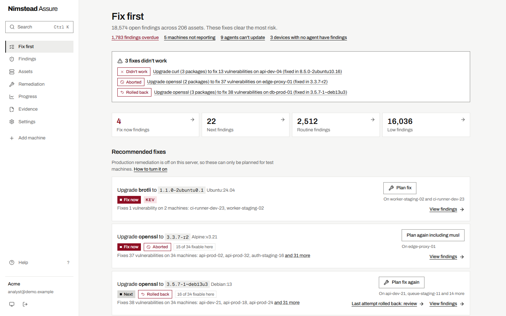
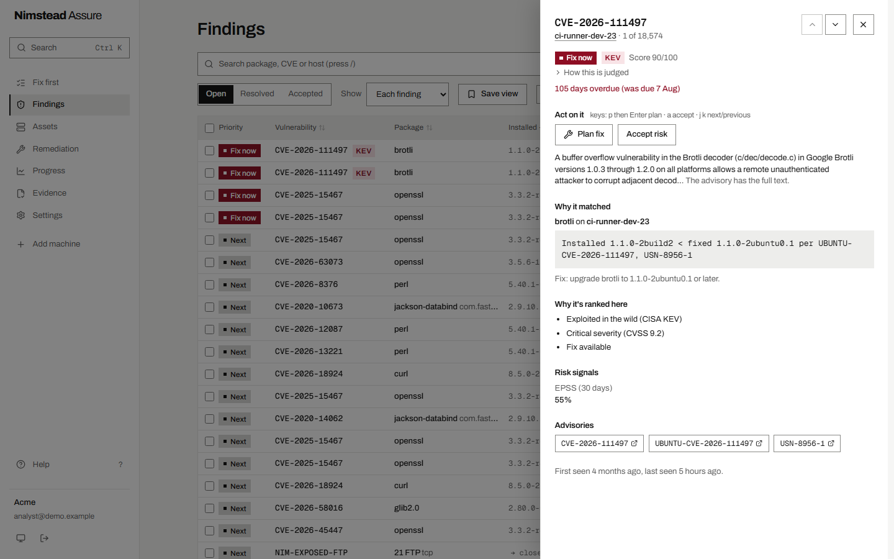
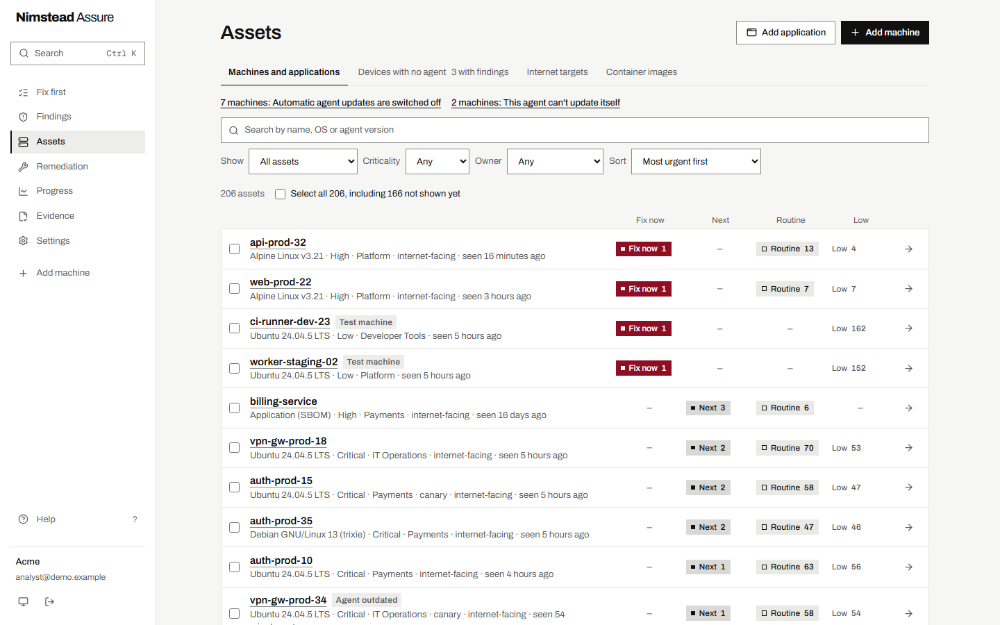
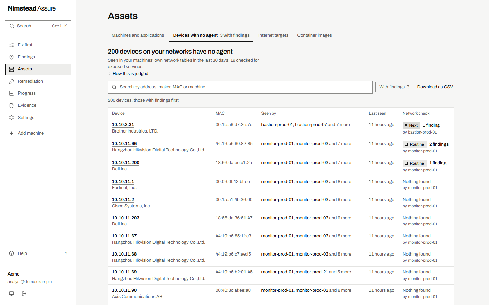
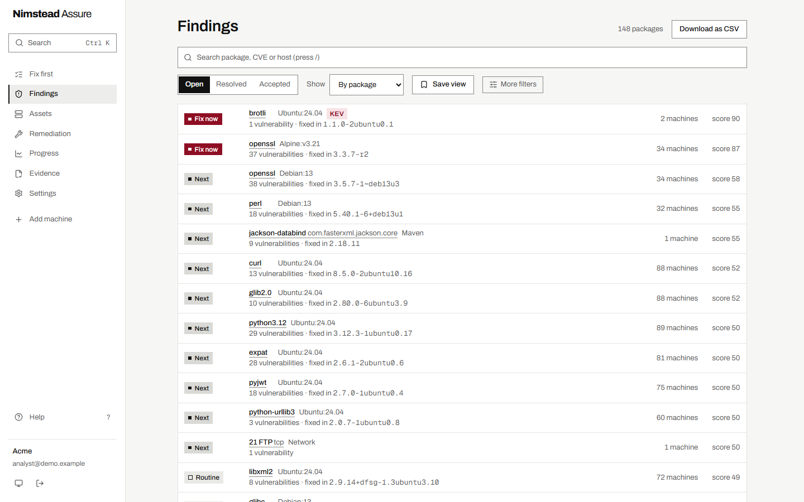
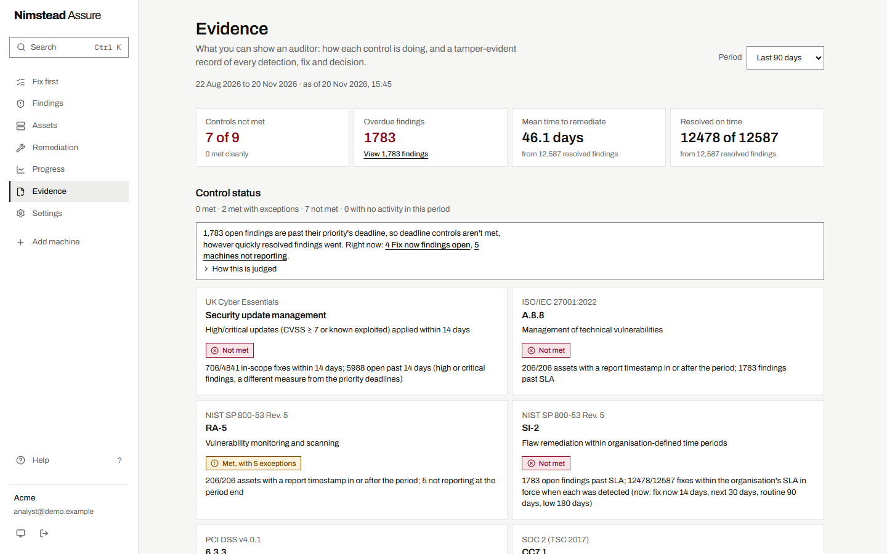
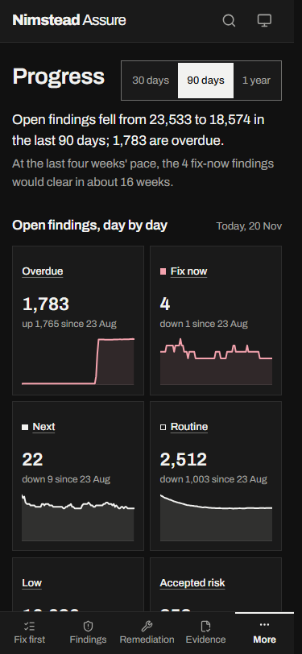
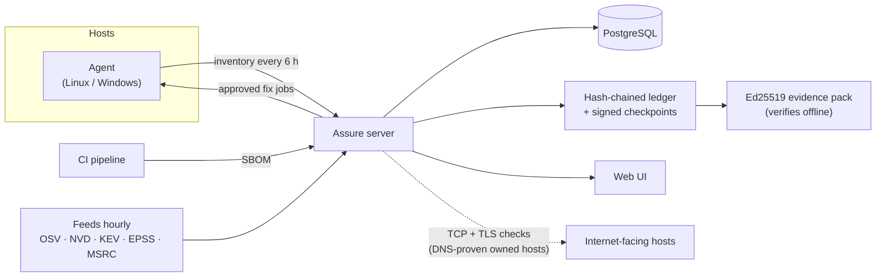

<h1 align="center">Nimstead Assure</h1>

<p align="center"><b>Find what's vulnerable. Fix it safely. Prove it to an auditor.</b></p>

<p align="center">
  <a href="https://github.com/Nimstead/assure/releases"></a>
  <a href="https://github.com/Nimstead/assure/actions/workflows/ci.yml"></a>
  <a href="LICENSE.md"></a>
  
  
</p>

<p align="center"></p>

Nimstead Assure scans your Linux and Windows machines, their containers and your applications' dependencies for known vulnerabilities, tells you which few upgrades clear the most real risk, can apply them for you with automatic rollback, shows whether your risk is going down and which team is behind, and keeps a tamper-evident record your auditor can check without asking us.

> [!NOTE]
> **Early access (v0.14).** Everything below works and is proven on real systems, but expect rough edges and breaking changes before 1.0. Until a release is promoted to the stable channel (none has been yet), set `NIMSTEAD_UPDATE_CHANNEL=preview` (or `beta` once one exists) in `.env` so your server hears about updates. Run it on test machines first; automated fixes stay limited to machines you enrol as test machines until you turn them on for production. Tell us what breaks: [open an issue](https://github.com/Nimstead/assure/issues/new/choose) or email dev@nimstead.systems.

## What it does

- **Finds vulnerabilities without the noise.** Agents report installed packages; Nimstead matches them against OSV advisories using each distro's own version rules and source-package names, so backported fixes aren't flagged. Results agree with the OSV API on real data. On Windows, the OS and Microsoft's own products (Edge, .NET, SQL Server, Exchange, SharePoint, Defender, Microsoft 365 Apps) are matched against Microsoft's own fixed builds, 100 common third-party apps against NVD and the vendors' own CVE records, and settings that leave a patched machine exposed (Secure Boot certificates, SMB signing, NTLMv1, WDigest and more) are reported too. End of support is flagged for Windows, Microsoft products and curated apps.
- **Says how sure it is.** Every check on a host gets a verdict and a confidence, and the scan report says what stopped any check from concluding instead of calling the host clean. It also shows how a host's weaknesses chain into a compromise, from getting in to reaching the next machine, and the single fix that breaks each chain.
- **Sees inside your containers, Kubernetes included.** The agent already on a Linux host or Kubernetes node reads its running Docker, Podman, containerd and CRI-O containers, with no sensor, no DaemonSet, no Kubernetes token and no registry credentials. It reads each image's distribution packages and what its build added: Python, npm, Java (jars nested in Spring Boot jars and wars too) and Go binaries, each with where it sits in the image, and never reports the base image's own packages twice. Each image is listed once, however many machines run it, and fixed once: Fix first names the packages each rebuild must bring, and its findings close when no machine runs the old image any more.
- **Covers your applications too.** Upload a CycloneDX or SPDX SBOM from CI, and PyPI, npm, Maven, NuGet, RubyGems, Go, crates.io, Packagist, Hex and Pub packages are matched the same way, and a container image's OS packages with its distribution's own advisories (Syft and Trivy output as it comes).
- **Tells you what to fix first.** CISA KEV first, then EPSS likelihood, CVSS, how critical the machine is and whether it faces the internet, with a plain-English reason for every score. The home screen shows *upgrades* ("openssl → fixes 12 vulnerabilities on 3 hosts"), not a wall of CVEs.
- **Knows what's actually running, and what still runs the old code.** The agent reads which installed packages running programs have loaded and which of those listen on the network ("libssl3t64 is loaded by nginx.service, listening on 0.0.0.0:443"), with no kernel sensor or eBPF. A network flaw in a library a listening service loaded ranks higher; one in code nothing has loaded for a week ranks lower, never hidden. A fix only counts once no program still runs the copy it replaced: Fix first lists what to **restart to finish**, and automated fixes restart those services themselves, inside their health checks and rollback.
- **Shows which machines fall together, and the one fix that stops it.** On Linux, the agent also reads who can get in: sshd's settings, accounts, `sudo` and files root runs, plus the SSH keys each machine holds and trusts, as fingerprints only. Each machine's report says how an attacker gets from the network to root, knowing which user the way in runs as. Across the fleet, a machine links to another only when a key it holds is trusted there for an account that machine's sshd lets in, judged by sshd's own rules and confirmed when a connection was seen. **Cut these first** ranks the single actions, such as retiring one key or closing one way in, that cut the most machines off from every way in.
- **Works at fleet scale.** Findings page through tens of thousands of rows, sort by any column, and group by vulnerability or package. Select findings to plan the fix on every machine they're on, or accept the risk with one recorded reason. Save filter sets as views, search everything with Ctrl K, and step through findings with the keyboard. Assets has search, filters and bulk edit.
- **Fixes things without surprises.** You approve a fix, after seeing every package it changes and the machine it runs on. It goes to canary machines first, with a dry run that refuses anything outside the plan, a rollback copy taken before every change, health checks after, and automatic rollback if they fail. A fix only counts once the next inventory shows the vulnerability is gone.
- **Proves the work.** Every detection, fix and decision lands in a hash-chained ledger with signed off-database checkpoints. Ed25519-signed evidence packs map to Cyber Essentials, ISO 27001 A.8.8, NIST RA-5/SI-2, PCI DSS 6.3.3 and CIS 7, and verify offline against a pinned key fingerprint.
- **Shows whether it's working, and who is behind.** Give each machine an owner (or let its install command do it), and Progress shows day by day whether overdue, fix-now and open findings are falling, whether fixes keep up with what's found, and which team has the most overdue. It's rebuilt from the same signed ledger the evidence packs use, so its numbers match theirs, and a weekly summary can go to Slack or email.
- **Puts the work in each team's own tracker.** Connect Jira or GitLab and each team gets one ticket per fix in its own project ("Upgrade openssl to 3.0.15 on 14 machines"), not one per CVE per machine. Nimstead keeps it current, closes it only when the machines' own inventory shows the fix (saying why each machine left), and reopens it if a fix regresses or someone closes it while machines are still exposed. Preview shows every ticket before anything is sent.
- **Watches your edge, and what's on your network.** Internet hosts you prove you own (DNS TXT) are checked for exposed risky services, weak TLS, source and config files served by mistake, and known-bad service versions, and a finding there closes only when the scan proves it fixed. Devices on your networks with no agent are listed by maker, from your machines' own network tables, without sending them anything; a machine you opt in locally can check its neighbours for exposed services too.
- **Keeps itself current, safely.** Agents update themselves only from releases signed by the Nimstead release key, which your server never holds, so a compromised server can't push code to your machines. The server tells you when a release is out, and `deploy/update.sh` installs it with a database backup and automatic rollback. Machines that stop reporting are flagged.
- **Fits your organisation.** An owner (team) on every asset, set once on the install command; OIDC single sign-on with verified domains, admin and read-only roles, webhook and email alerts for failed fixes and new urgent findings, keys in Vault and checkpoints in object-locked S3.

The screenshots come from a demo built on a real run ([`sandbox/demo.py`](sandbox/demo.py)): five disposable Linux machines (Ubuntu 24.04, Debian 13, AlmaLinux 9, Alpine 3.21) running the real agent against real vulnerability feeds, with real fixes, a real rollback and a fix the dry run refused. It was grown to 206 machines by cloning those real inventories, with 200 devices found in the machines' own network tables. Its curl rollout and its 120 days of history are simulated over those real findings ([`sandbox/progress_demo.py`](sandbox/progress_demo.py)), so Progress has a past to show; everything on screen is the product's own output.

| Is it working, and who is behind? Progress over 90 days, rebuilt from the signed ledger |
|---|
|  |

| A rollout canary first, a fix the dry run refused, and one rolled back when it broke a service | Why a finding matched, and why it's ranked there |
|---|---|
|  |  |

| Every machine with its owner, sorted by urgency | 200 devices with no agent, from your machines' own network tables |
|---|---|
|  |  |

| The fixes, by package, across the fleet | Controls an auditor can check | Light and dark, down to phone width |
|---|---|---|
|  |  |  |

## Get started

You need Docker with Compose v2.

```bash
git clone https://github.com/Nimstead/assure.git && cd assure
```

```bash
cp .env.example .env
```

Set `POSTGRES_PASSWORD` in `.env` to a long random value, then:

```bash
docker compose up -d
```

Open http://localhost:8000, create an account and follow **Add your first machine**. The [install guide](docs/install.md) covers HTTPS, enrolling Linux and Windows machines, turning on automated fixes, upgrades, backups and running without Docker.

## How it works



1. **Inventory.** The agent, one standard-library Python file, reports installed packages. CI uploads SBOMs for applications.
2. **Match.** The server matches packages against advisories using each ecosystem's own version rules, then scores each finding by real-world risk.
3. **Fix.** An admin approves a fix, or lets the trust ladder approve some on its own. Canaries first, then everything else, pinned to the versions the canaries proved.
4. **Verify.** A fix only counts once the next inventory shows the vulnerability is gone. Every step lands in the ledger.

## Proven on real systems

Not just unit tests. Each of these ran end to end in a disposable VM or WSL distro; the scripts and logs are in [`sandbox/`](sandbox) and the details in [STATUS.md](STATUS.md).

| Platform | Detect | Fix verified by inventory | Automatic rollback |
|---|---|---|---|
| Debian 13 · Ubuntu 24.04 | ✓ | ✓ apt | ✓ after a real service failure |
| AlmaLinux 9 | ✓ | ✓ dnf | ✓ after a real service failure |
| Alpine 3.21 | ✓ | ✓ apk | ✓ after an injected failure |
| openSUSE Leap 16.0 | ✓ | ✓ zypper | ✓ after a real service failure; snapper also undoes install-script side effects |
| Windows Server 2025 | ✓ | ✓ cumulative update as SYSTEM | ✓ after an injected failure (DISM removal); permanent updates refused up front |
| Windows Server 2019 | ✓ | ✓ cumulative and .NET Framework updates through the scheduled task | ✓ after an injected failure, for both |
| Windows Server 2022 | ✓ | ✓ cumulative and .NET Framework updates through the scheduled task | ✓ .NET Framework update after an injected failure |
| Windows 11 Pro 26H2 · Enterprise · Pro in German | ✓ | ✓ cumulative update as SYSTEM, through the scheduled task | ✓ after an injected failure (DISM removal), and after a power cut mid-rollback; every package the update brings checked up front |
| Windows 10 22H2 | ✓ | ✓ the last free cumulative (2025-10) through the scheduled task; newer updates need an ESU licence and are refused with no change | not tried on 22H2 (see LTSC) |
| Windows 10 Enterprise LTSC 2021 (English and German) | ✓ | ✓ by hand; the expired evaluation image shut itself down before the scheduled task could | ✓ after an injected failure; a power cut mid-install reported as no change |

Plus real Keycloak SSO, DNS, SMTP and webhook integrations, the ticket loop on a real GitLab (opened, fixed by a real package upgrade, closed, reopened), Vault and S3 object-lock key storage, the Docker Compose install, and 1,000-host performance runs on SQLite and PostgreSQL 17. About 1,620 API tests run on both databases in CI.

## Known limitations

The full, honest list is in [STATUS.md](STATUS.md#not-proven--known-gaps-honest). The ones you're most likely to meet:

- Windows remediation is proven on Windows Server 2019, 2022 and 2025, Windows 11 and Windows 10 22H2. Server 2016 is untried, and a fix newer than 2025-10 on Windows 10 needs an Extended Security Updates licence, which we haven't had to test with. The Windows agent needs no Python (it brings its own, signed); that install path is proven on Windows 11.
- Windows third-party apps cover about 100 curated products, each labelled in the finding by how it was proven (old to new on a real machine, a real install's name, or the name pattern only); other apps are inventoried but not matched. App updates through winget can't be rolled back, so a person always approves them as such.
- Rollback restores package files and the package database everywhere, but undoes changes install scripts made elsewhere only with zypper and snapper.
- SBOMs must be JSON (CycloneDX 1.4–1.7, SPDX 2.2/2.3). Findings mean a package is present, not that the vulnerable code is reachable.
- Containers: Docker, Podman, containerd and CRI-O on Linux, running containers only. Rootless containers, Ruby, PHP, .NET and Rust packages inside images, jars without Maven metadata and RHEL 8-family images' OS packages (rpm's Berkeley DB) aren't read yet; each image says what wasn't read. Kubernetes is proven on real containerd and CRI-O with containers created as the kubelet creates them, not yet on a full cluster.
- The AI features (optional) have only been tested against a mocked API.
- Tickets go to Jira or GitLab. GitLab is proven end to end on a real server; every Jira call is checked against Atlassian's published API spec and tested against a model of its behaviour, but not yet run against a live site. ServiceNow isn't supported yet, and nothing flows back from the tracker except whether a ticket is closed.

## Documentation

Start with the [documentation index](docs/README.md) for tutorials, task guides, reference, and explanations. The same documentation is published, with search, at **<https://docs.nimstead.systems/>**. This repository is the source; the site can lag a release.

| | |
|---|---|
| [Install](docs/install.md) | Docker Compose, HTTPS, enrolling machines, automated fixes, upgrades, backups |
| [Configuration](docs/configuration.md) | Every environment variable |
| [STATUS.md](STATUS.md) | What is proven, how, and what isn't |
| [DECISIONS.md](DECISIONS.md) | Why things are the way they are, including the threat model |
| [CHANGELOG.md](CHANGELOG.md) | What changed in each release |
| [CONTRIBUTING.md](CONTRIBUTING.md) | Development setup, tests and how we work |
| [SECURITY.md](SECURITY.md) | How to report a vulnerability |

## Repository layout

| Directory | What it is |
|---|---|
| [`api/`](api) | The server: FastAPI and SQLAlchemy, feeds, matching, risk, remediation, evidence |
| [`agent/`](agent) | The agent: one standard-library Python file for Linux (apt, dnf, zypper, apk) and Windows |
| [`web/`](web) | The UI: React and TanStack, served by the API once built |
| [`sandbox/`](sandbox) | Real-host and real-service proofs in disposable WSL distros and VMs |
| [`docs/`](docs) | Install and configuration guides |

## Licence

[Functional Source License 1.1, Apache 2.0 future licence](LICENSE.md) (FSL-1.1-ALv2). You can use, modify and self-host Nimstead Assure for anything except offering a product or service that competes with it. Two years after each release, that release becomes available under Apache 2.0.
