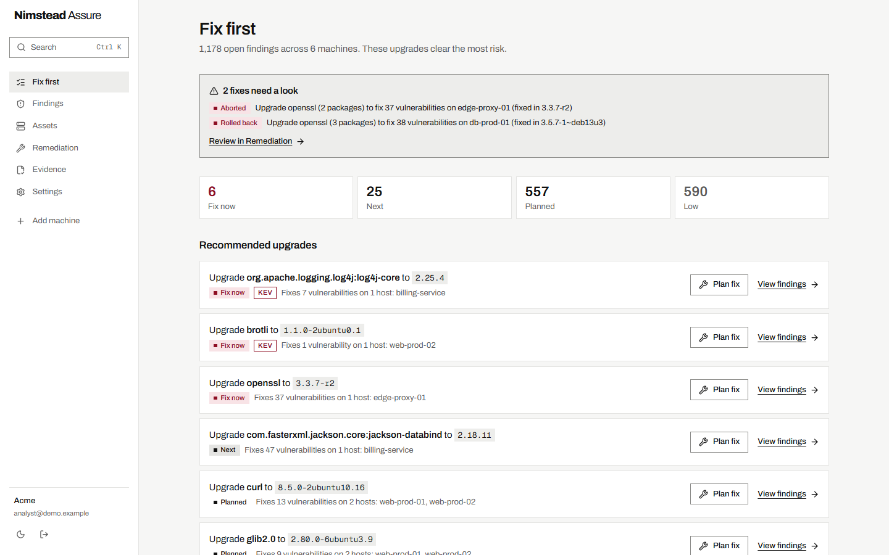
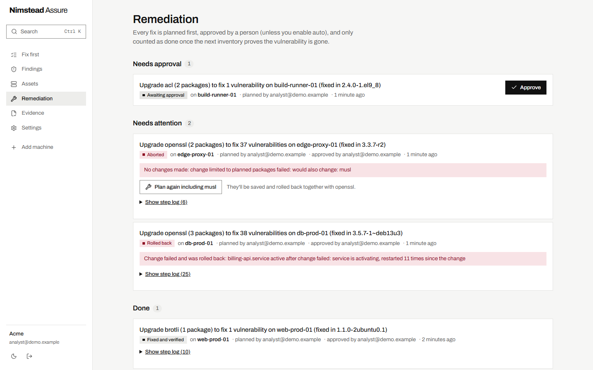
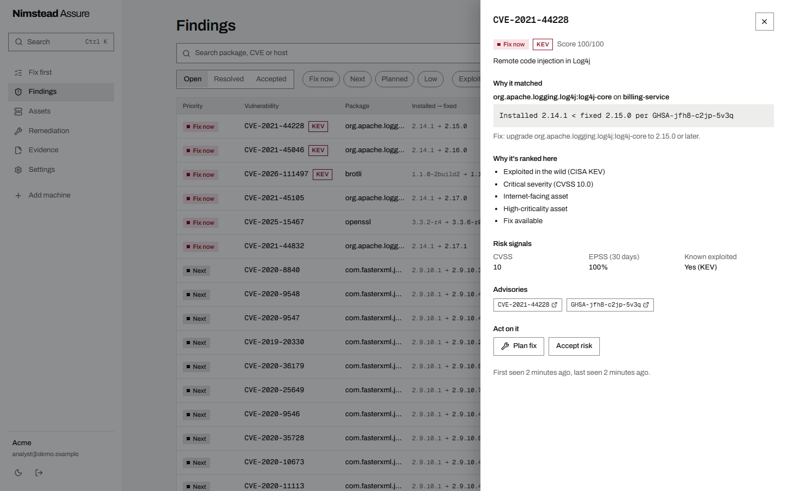
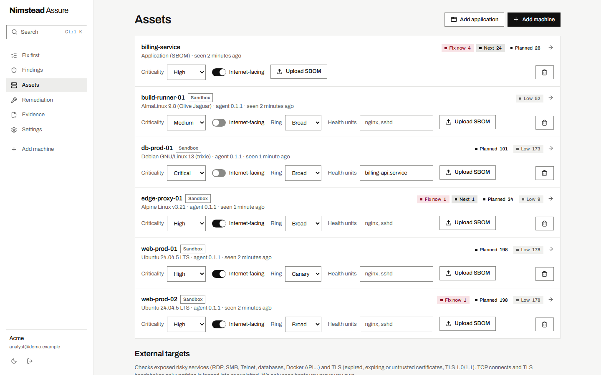
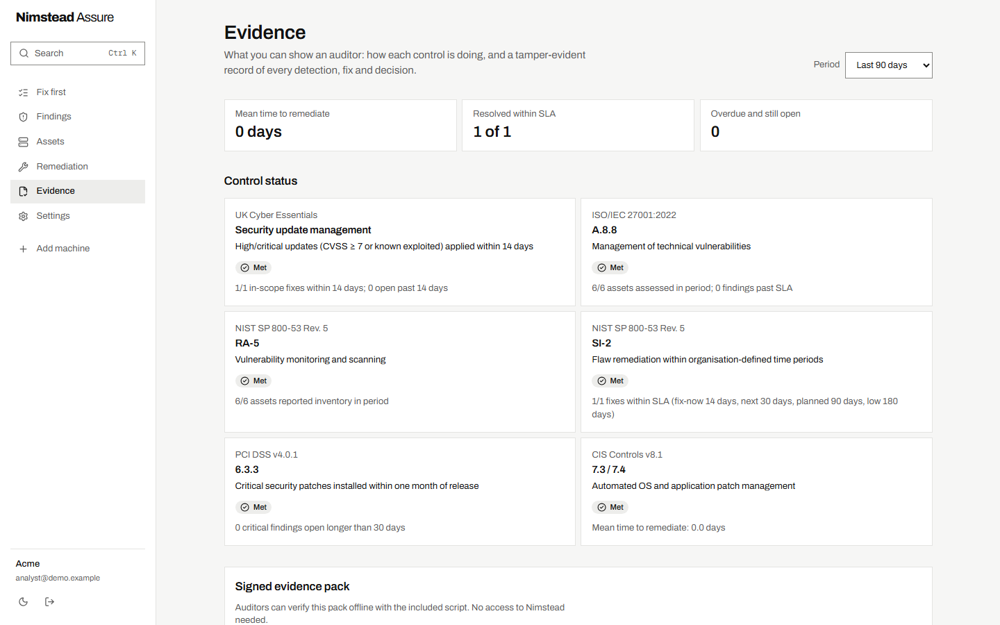
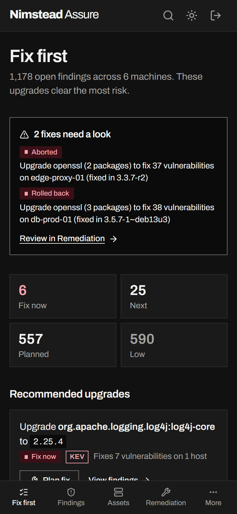
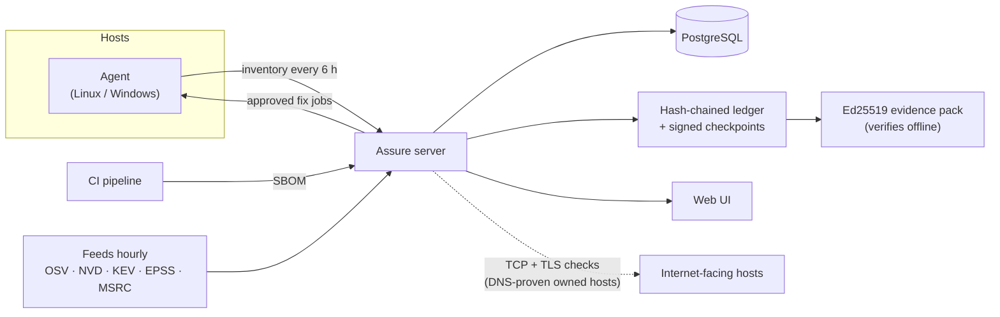

<h1 align="center">Nimstead Assure</h1>

<p align="center"><b>Find what's vulnerable. Fix it safely. Prove it to an auditor.</b></p>

<p align="center">
  <a href="https://github.com/Nimstead/assure/releases"></a>
  <a href="https://github.com/Nimstead/assure/actions/workflows/ci.yml"></a>
  <a href="LICENSE.md"></a>
  
  
</p>

<p align="center"></p>

Nimstead Assure scans your Linux and Windows machines and your applications' dependencies for known vulnerabilities, tells you which few upgrades clear the most real risk, can apply them for you with automatic rollback, and keeps a tamper-evident record your auditor can check without asking us.

> [!NOTE]
> **Early access (v0.1).** Everything below works and is proven on real systems, but expect rough edges and breaking changes before 1.0. Run it on test machines first; automated fixes stay limited to machines you mark as sandbox until you turn them on for production. Tell us what breaks: [open an issue](https://github.com/Nimstead/assure/issues/new/choose) or email dev@nimstead.systems.

## What it does

- **Finds vulnerabilities without the noise.** Agents report installed packages; Nimstead matches them against OSV advisories using each distro's own version rules and source-package names, so backported fixes aren't flagged. Results agree with the OSV API on real data. Windows updates come from MSRC, and common Windows apps (Chrome, Firefox, 7-Zip, VS Code and more) from NVD.
- **Covers your applications too.** Upload a CycloneDX or SPDX SBOM from CI, and PyPI, npm, Maven, NuGet, RubyGems, Go, crates.io, Packagist, Hex and Pub packages are matched the same way.
- **Tells you what to fix first.** CISA KEV first, then EPSS likelihood, CVSS, how critical the machine is and whether it faces the internet, with a plain-English reason for every score. The home screen shows *upgrades* ("openssl → fixes 12 vulnerabilities on 3 hosts"), not a wall of CVEs.
- **Fixes things without surprises.** You approve a fix. It goes to canary machines first, with a dry run that refuses anything outside the plan, a rollback copy taken before every change, health checks after, and automatic rollback if they fail. A fix only counts once the next inventory shows the vulnerability is gone.
- **Proves the work.** Every detection, fix and decision lands in a hash-chained ledger with signed off-database checkpoints. Ed25519-signed evidence packs map to Cyber Essentials, ISO 27001 A.8.8, NIST RA-5/SI-2, PCI DSS 6.3.3 and CIS 7, and verify offline against a pinned key fingerprint.
- **Watches your edge.** Internet hosts you prove you own (DNS TXT) are checked for exposed risky services and weak TLS.
- **Fits your organisation.** OIDC single sign-on with verified domains, admin and read-only roles, webhook and email alerts for failed fixes and new urgent findings, keys in Vault and checkpoints in object-locked S3.

Every screenshot here is from a real run ([`sandbox/demo.py`](sandbox/demo.py)): five disposable Linux machines (Ubuntu 24.04, Debian 13, AlmaLinux 9, Alpine 3.21) running the real agent, real vulnerability feeds, an application SBOM, and real fixes on those machines.

| A fix verified, a fix rolled back when it broke a service, and one the dry run refused | Why a finding matched, and why it's ranked there |
|---|---|
|  |  |

| Every machine, its ring and its health checks | Controls an auditor can check | Light and dark, down to phone width |
|---|---|---|
|  |  |  |

## Get started

You need Docker with Compose v2.

```bash
git clone https://github.com/Nimstead/assure.git && cd assure
```

```bash
cp .env.example .env
```

Set `POSTGRES_PASSWORD` in `.env` to a long random value, then:

```bash
docker compose up -d
```

Open http://localhost:8000, create an account and follow **Add your first machine**. The [install guide](docs/install.md) covers HTTPS, enrolling Linux and Windows machines, turning on automated fixes, upgrades, backups and running without Docker.

## How it works



1. **Inventory.** The agent, one standard-library Python file, reports installed packages. CI uploads SBOMs for applications.
2. **Match.** The server matches packages against advisories using each ecosystem's own version rules, then scores each finding by real-world risk.
3. **Fix.** An admin approves a fix, or lets the trust ladder approve some on its own. Canaries first, then everything else, pinned to the versions the canaries proved.
4. **Verify.** A fix only counts once the next inventory shows the vulnerability is gone. Every step lands in the ledger.

## Proven on real systems

Not just unit tests. Each of these ran end to end in a disposable VM or WSL distro; the scripts and logs are in [`sandbox/`](sandbox) and the details in [STATUS.md](STATUS.md).

| Platform | Detect | Fix verified by inventory | Automatic rollback |
|---|---|---|---|
| Debian 13 · Ubuntu 24.04 | ✓ | ✓ apt | ✓ after a real service failure |
| AlmaLinux 9 | ✓ | ✓ dnf | ✓ after a real service failure |
| Alpine 3.21 | ✓ | ✓ apk | ✓ after an injected failure |
| openSUSE Leap 16.0 | ✓ | ✓ zypper | ✓ after a real service failure; snapper also undoes install-script side effects |
| Windows Server 2025 | ✓ | ✓ cumulative update as SYSTEM | ✓ after an injected failure (DISM removal); permanent updates refused up front |

Plus real Keycloak SSO, DNS, SMTP and webhook integrations, Vault and S3 object-lock key storage, the Docker Compose install, and 1,000-host performance runs on SQLite and PostgreSQL 17. 579 API tests run on both databases in CI.

## Known limitations

The full, honest list is in [STATUS.md](STATUS.md#not-proven--known-gaps-honest). The ones you're most likely to meet:

- Windows remediation is proven on Windows Server 2025; Windows 10/11 machines are detected but fixes there haven't been run in a VM.
- Windows third-party apps cover about 18 common products; other apps are inventoried but not matched.
- Rollback restores package files and the package database everywhere, but undoes changes install scripts made elsewhere only with zypper and snapper.
- SBOMs must be JSON (CycloneDX 1.4–1.6, SPDX 2.2/2.3). Findings mean a package is present, not that the vulnerable code is reachable.
- The AI features (optional) have only been tested against a mocked API.

## Documentation

| | |
|---|---|
| [Install](docs/install.md) | Docker Compose, HTTPS, enrolling machines, automated fixes, upgrades, backups |
| [Configuration](docs/configuration.md) | Every environment variable |
| [STATUS.md](STATUS.md) | What is proven, how, and what isn't |
| [DECISIONS.md](DECISIONS.md) | Why things are the way they are, including the threat model |
| [CHANGELOG.md](CHANGELOG.md) | What changed in each release |
| [CONTRIBUTING.md](CONTRIBUTING.md) | Development setup, tests and how we work |
| [SECURITY.md](SECURITY.md) | How to report a vulnerability |

## Repository layout

| Directory | What it is |
|---|---|
| [`api/`](api) | The server: FastAPI and SQLAlchemy, feeds, matching, risk, remediation, evidence |
| [`agent/`](agent) | The agent: one standard-library Python file for Linux (apt, dnf, zypper, apk) and Windows |
| [`web/`](web) | The UI: React and TanStack, served by the API once built |
| [`sandbox/`](sandbox) | Real-host and real-service proofs in disposable WSL distros and VMs |
| [`docs/`](docs) | Install and configuration guides |

## Licence

[Functional Source License 1.1, Apache 2.0 future licence](LICENSE.md) (FSL-1.1-ALv2). You can use, modify and self-host Nimstead Assure for anything except offering a product or service that competes with it. Two years after each release, that release becomes available under Apache 2.0.
